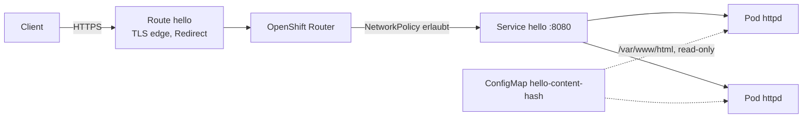
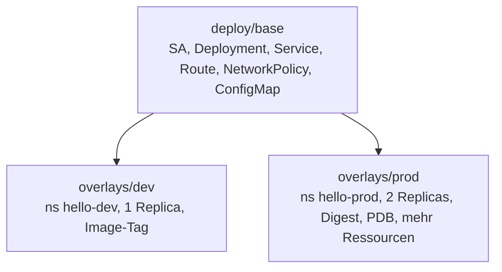

<!-- TEMPLATE (YAML): Aufbau der Manifeste und Umgebungen anpassen. -->

# Architektur

## Laufzeit

## Kustomize-Aufbau

## Ressourcen
| Datei | Zweck |
|---|---|
| `base/serviceaccount.yaml` | Eigene Identität, kein automatisch gemountetes Token |
| `base/deployment.yaml` | httpd-Container mit Probes, Limits, Security Context, Anti-Affinity |
| `base/service.yaml` | ClusterIP auf Port `http` (8080) |
| `base/route.yaml` | Externer Zugang, TLS am Router terminiert |
| `base/networkpolicy.yaml` | Nur Router darf auf die Pods zugreifen |
| `base/content/index.html` | Inhalt, per `configMapGenerator` mit Hash-Suffix |
| `overlays/prod/pdb.yaml` | Mindestens ein Pod bei Wartung verfügbar |
| `overlays/prod/patch-resources.yaml` | Höhere Requests/Limits in Produktion |

## Prinzipien
- **Base ist umgebungsneutral.** Alles, was sich pro Umgebung unterscheidet, gehört ins Overlay.
- **Git ist die Wahrheit.** Der Cluster wird per GitOps (z.B. OpenShift GitOps/Argo CD) aus `deploy/overlays/<env>` synchronisiert.
- **Konfigurationsänderung = Rollout.** ConfigMaps über Generatoren, damit sich der Name ändert.
