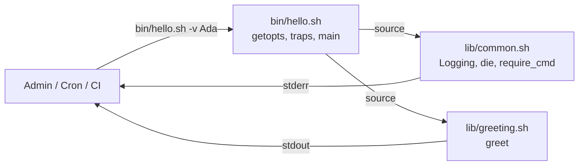

<!-- TEMPLATE (Bash): Aufbau und Datenfluss. Diagramm und Tabelle anpassen. -->

# Architektur

## Überblick
Einstiegsskripte in `bin/` sind dünn: Sie parsen Optionen, richten Traps ein und rufen
Funktionen aus `lib/` auf. Die Logik in `lib/` ist ohne Prozessstart testbar.

## Bestandteile
| Datei | Verantwortung | Hängt ab von |
|---|---|---|
| `bin/hello.sh` | CLI, Optionen, Exit-Codes, Traps | `lib/common.sh`, `lib/greeting.sh` |
| `lib/common.sh` | Logging, Abbruch, Voraussetzungen prüfen | – |
| `lib/greeting.sh` | Fachlogik | – |

## Prinzipien
- `lib/`-Dateien haben einen Include-Guard und definieren nur Funktionen.
- `bin/`-Skripte rufen `main "$@"` nur auf, wenn sie direkt ausgeführt werden – so kann bats sie sourcen.
- Pfade relativ zu `SCRIPT_DIR`, nie zum aktuellen Arbeitsverzeichnis.
- Externe Kommandos (`oc`, `jq`, `curl`) am Anfang mit `require_cmd` prüfen.
