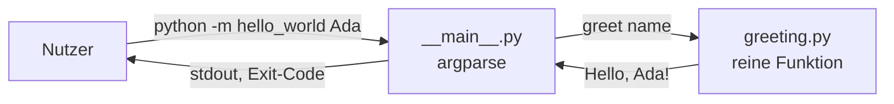

<!-- TEMPLATE (Python): Aufbau und Datenfluss. Diagramm und Tabelle anpassen. -->

# Architektur

## Überblick
Zwei Schichten: eine dünne CLI und eine reine Fachlogik.

## Module
| Modul | Verantwortung | Darf abhängen von |
|---|---|---|
| `hello_world.greeting` | Begrüßungstext erzeugen | nur Standardbibliothek |
| `hello_world.__main__` | CLI-Argumente, Ausgabe, Exit-Code | `greeting` |

## Prinzipien
- **Abhängigkeiten zeigen nach innen:** CLI kennt Fachlogik, nie umgekehrt.
- **Fachlogik ist ohne Mocks testbar**, weil sie keine I/O macht.
- **Konfiguration** über Umgebungsvariablen, gelesen nur in der äußersten Schicht.
- Neue Ein-/Ausgabewege (z.B. Web-API) kommen als eigenes Modul neben `__main__.py`.
